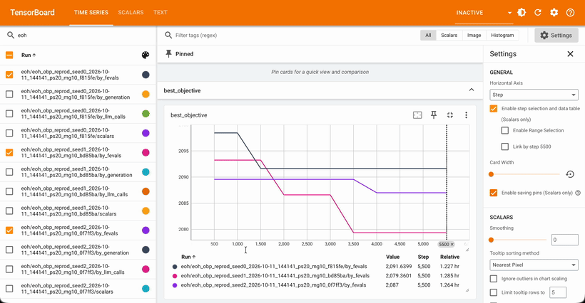

<p align="center">
  
</p>

<h1 align="center">EvoKit: Modular Framework for LLM-Guided Algorithm Design</h1>

[](https://www.python.org/downloads/) [](LICENSE) [](tests/) [](https://optuna.org/) [](https://github.com/vllm-project/vllm)

**EvoKit** is an open toolkit for Automated Heuristic Design (AHD) and LLM-guided program synthesis.

Academic AHD repositories (EoH, ReEvo, OpenEvolve, LLM4AD) bundle search strategy, execution sandbox, and benchmark into monolithic scripts. EvoKit decouples these into pluggable, contract-driven components around an **invariant evolution engine**, so a new method is a config swap of two plugins rather than a rewrite.

## Why EvoKit?

Existing AHD frameworks each hard-wire one philosophy. **OpenEvolve** ships a single quality-diversity algorithm (islands + MAP-Elites) — powerful, but you cannot drop in EoH's thought–code operators or ReEvo's reflection loop without forking the controller. **LLM4AD** is a rich library of *tasks and methods*, but methods and benchmarks are coupled through method-specific interfaces, so mixing a new search strategy with an existing task means rewriting glue code. In both, the search strategy, the population/archive, and the evaluation sandbox are entangled.

EvoKit's bet is the opposite: **one invariant engine, three independently swappable pillars.** A method is defined by *which population plugin and which mutation plugin* a YAML config names — the benchmark, sandbox, storage, and telemetry are shared and untouched.

| | **OpenEvolve** | **LLM4AD** | **EvoKit** |
|---|---|---|---|
| Primary unit | one QD algorithm | task + method library | **3 pluggable pillars + invariant engine** |
| Add a new search method | fork the controller | implement a method interface | **drop in a Pillar-2 plugin, name it in YAML** |
| Swap archive independently of mutation | ✗ (coupled) | partial | **✓ (Pillar 1 ⟂ Pillar 2)** |
| Mix any method × any benchmark | ✗ | coupled interfaces | **✓ contract-driven** |
| Methods built-in | OpenEvolve | many (per-method) | **EoH · ReEvo · OpenEvolve** (more coming) |
| Sandbox as a swappable component | built-in | built-in | **✓ (subprocess / MCP, pluggable)** |
| Telemetry out of the box | custom | custom | **Optuna DB + TensorBoard + `.py` artifacts** |
| Held-out test split enforced | ✗ | varies | **✓ zero-leakage by contract** |

> **Takeaway:** OpenEvolve and LLM4AD make you adopt *their* loop. EvoKit makes the loop invariant and lets you plug paradigms into it — so OpenEvolve, EoH, and ReEvo all run on the *same* engine, differing only by two config lines.

---

## See it in action

Every run streams live telemetry to TensorBoard — the best-so-far objective with a **switchable x-axis** (generations · LLM calls · function evaluations · wall-clock) and a per-run metadata panel, across seeds and methods.

<p align="center">
  
</p>

See [docs/tutorials/telemetry.md](docs/tutorials/telemetry.md) for the Optuna Dashboard and code-artifact views too.

---

## 📰 News

> **EvoKit is brand new** — first public cut, **2026-10-11**. APIs may still shift.

**Methods available now:**

- [x] **OpenEvolve** — islands + per-island MAP-Elites + archive + novelty + ring migration
- [x] **EoH** — Evolution of Heuristics (E1/E2 exploration, M1/M2 mutation)
- [x] **ReEvo** — Reflective Evolution (short/long-term reflection loops)

**On the roadmap:**

- [ ] **LLaMEA** — (1+λ) LLM evolutionary algorithm
- [ ] **HSEvo** — harmony-search diversity
- [ ] **EoH-S** — automated heuristic-set design (AAAI '26)
- [ ] **MCTS-AHD** — Monte-Carlo tree search for AHD

---

## Install

```bash
git clone https://github.com/taindp98/myirace.git
cd myirace/EvoKit
pip install -e .            # or: pip install -r requirements.txt
evokit --help
```

Full setup — optional extras, self-hosted vLLM, and cloud API providers (OpenAI / OpenRouter, API keys) → **[docs/tutorials/setup.md](docs/tutorials/setup.md)**.

---

## Quickstart

```bash
# Run a method–benchmark preset (live), or add --dry-run for a zero-cost mock loop.
evokit run -c evokit/configs/eoh_obp.yaml --dry-run
```

Or assemble the pipeline in Python:

```python
from evokit.loader import load_yaml_config
from evokit.main import assemble_engine

config = load_yaml_config("evokit/configs/eoh_obp.yaml")
engine = assemble_engine(config)
summary = engine.run()
print(summary["best_elites"][0]["fitness"], summary["trajectory"][-1]["gap"])
```

Each run produces: an Optuna-compatible SQLite DB, standalone `.py` code artifacts, and TensorBoard scalar logs (objective vs. generations / LLM calls / function evaluations / wall-clock). See **[Telemetry](docs/tutorials/telemetry.md)**.

---

## How it works — the 3 pillars

An immutable `EvolutionContext` + structured `Individual` entities flow through pluggable components coordinated by the invariant engine:

```
Mutation Strategy  →  Evaluator Sandbox  →  Population Manager  →  Storage/Telemetry
   (Pillar 2)          (Pillar 3)             (Pillar 1)            (Optuna + TB + .py)
```

| Pillar | Contract | Included implementations |
|---|---|---|
| **1 · Population** | admit / select / archive | `LineageGraphArchive`, `ReflectionBuffer`, `MAPElitesGrid`, `OpenEvolveArchive` |
| **2 · Mutation** | prompt → code candidates | `EoHMutationStrategy`, `ReEvoMutationStrategy`, `OpenEvolveMutationStrategy`, `DiffMutationStrategy` |
| **3 · Evaluation** | run untrusted code safely | `SubprocessSandboxEvaluator`, `MCPEvaluator` |
| Benchmarks | train/test split + prompts | `OBPBenchmarkTask` (`obp_online`), `TSPBenchmarkTask` (`tsp_construct`) |
| Infra | gateway + persistence | `LLMGateway` (vLLM/cloud/mock), `ExperimentStorage` (SQLite + artifacts) |

Design tenets: **invariant core engine**, **3-pillar separation**, **`Individual` data contracts**, and **zero-leakage generalization** (held-out test split). Full rationale → [docs/tutorials/spec.md](docs/tutorials/spec.md).

---

## Documentation

**📘 Tutorials — for users & contributors** ([docs/tutorials/](docs/tutorials/))

| Topic | Link |
|---|---|
| Installation, vLLM self-host & cloud API keys | [setup.md](docs/tutorials/setup.md) |
| Method–benchmark tutorials & reproductions | [methods.md](docs/tutorials/methods.md) |
| CLI reference & parallelism | [cli.md](docs/tutorials/cli.md) |
| Telemetry (Optuna / TensorBoard / artifacts) | [telemetry.md](docs/tutorials/telemetry.md) |
| Extending EvoKit with custom plugins | [extending.md](docs/tutorials/extending.md) |
| Plugin development guide | [plugin_guide.md](docs/tutorials/plugin_guide.md) |
| Architecture specification | [spec.md](docs/tutorials/spec.md) |

**🛠 Development notes — milestones & history** ([docs/dev/](docs/dev/))

| Topic | Link |
|---|---|
| Roadmap (what's done / to-do) | [roadmap.md](docs/dev/roadmap.md) |
| Changelog (phase-by-phase log) | [changelog.md](docs/dev/changelog.md) |
| Bug fixes & known issues | [bugfixes.md](docs/dev/bugfixes.md) |

Per-package READMEs: [evokit/](evokit/) · [evokit/core/](evokit/core/) · [evokit/plugins/](evokit/plugins/)

---

## Tests

```bash
python -m pytest tests/ -q      # 27 passing
```

Covers component lifecycle, benchmark determinism, sandbox timeouts & MCP, parallel evaluation & gateway batching, all population/mutation plugins, and the end-to-end engine + storage.

---

## 🤝 Call for Contribution & Collaboration

EvoKit is brand new and built in the open — **we'd love your help shaping it.** The modular 3-pillar design means most contributions are self-contained: a new method is a population and/or mutation plugin plus a config, not a fork.

**Great ways to contribute:**

- **Add a method** from the [roadmap](docs/dev/roadmap.md) — LLaMEA, HSEvo, EoH-S, MCTS-AHD, MEoH — as pluggable Pillar-1/Pillar-2 components. Start from [docs/tutorials/extending.md](docs/tutorials/extending.md).
- **Add a benchmark task** (with train/test splits and a `PromptSpec`), or a new evaluation sandbox.
- **Improve the core** — gateway providers, caching, async evaluation, resume/checkpoint, analysis & plotting.
- **Report bugs or rough edges**, improve docs, or share results and reproductions.

**How to get started:**

1. Read [docs/tutorials/extending.md](docs/tutorials/extending.md) and the [architecture spec](docs/tutorials/spec.md).
2. Browse open items in the [development roadmap](docs/dev/roadmap.md) and [known issues](docs/dev/bugfixes.md).
3. Open an issue to discuss your idea, then send a PR — add tests under `tests/` and a note in [docs/dev/changelog.md](docs/dev/changelog.md).

**Collaboration & research:** if you're working on Automated Heuristic Design or LLM-guided program synthesis and want to collaborate — new paradigms, benchmarks, or a joint study — please open an issue or reach out. Academic and industrial collaborations are very welcome.

If EvoKit is useful to you, a ⭐ helps others discover it. Thank you!

---

## References & Acknowledgements

EvoKit stands on the shoulders of the open-source Automated Heuristic Design community. Its
modular pillars are directly inspired by, and in several cases reimplement the core ideas of,
these projects — our thanks to their authors:

- **[OpenEvolve](https://github.com/codelion/openevolve)** — open-source implementation of AlphaEvolve; the island + MAP-Elites + mixed-strategy database behind EvoKit's `OpenEvolveArchive`.
- **[LLM4AD](https://github.com/Optima-CityU/LLM4AD)** (Optima-CityU) — platform for LLM-based algorithm design; the reference for the Online Bin Packing / TSP evaluation pipelines and several method formulations. [[paper]](https://arxiv.org/abs/2412.17287)
- **[EoH](https://github.com/FeiLiu36/EoH)** (FeiLiu36) — Evolution of Heuristics; the dual thought–code operators (E1/E2/M1/M2) behind EvoKit's `EoHMutationStrategy`.
- **[ReEvo](https://github.com/ai4co/reevo)** (AI4CO) — Large Language Models as Hyper-Heuristics with Reflective Evolution (NeurIPS 2024); the short/long-term reflection loop behind EvoKit's `ReEvoMutationStrategy`. [[paper]](https://arxiv.org/abs/2402.01145)

Telemetry and infrastructure build on **[Optuna](https://github.com/optuna/optuna)** /
[optuna-dashboard](https://github.com/optuna/optuna-dashboard),
**[TensorBoard](https://github.com/tensorflow/tensorboard)**, and
**[vLLM](https://github.com/vllm-project/vllm)**.

EvoKit is an independent project and is not affiliated with or endorsed by the above; all
trademarks and credit belong to their respective authors.

---

## Citation

If you use EvoKit in your research, please cite it:

```bibtex
@software{evokit2026,
  title   = {EvoKit: A Modular Framework for LLM-Guided Algorithm Design},
  author  = {EvoKit Contributors},
  year    = {2026},
  version = {0.0.1},
  url     = {https://github.com/taindp98/myirace}
}
```

When you build on a specific method, please also cite its original work — see
[References & Acknowledgements](#references--acknowledgements) above
(OpenEvolve, LLM4AD, EoH, ReEvo).
